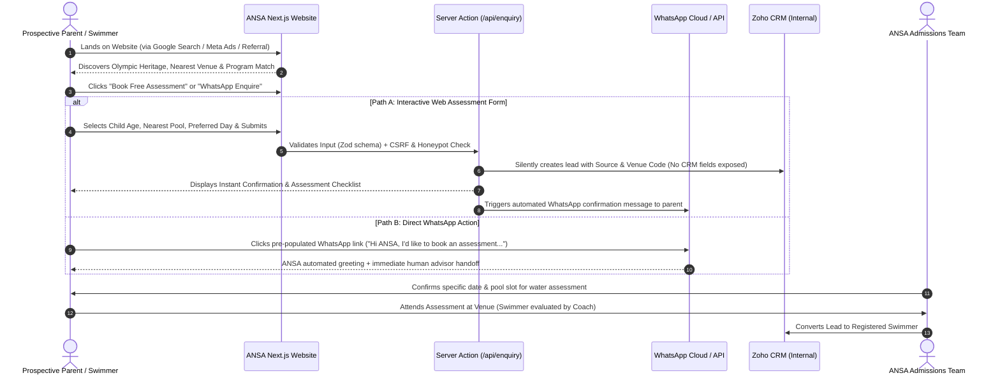

# Aqua Nation Sports Academy (ANSA) UAE — Digital Rebuild Master Architecture & Revamp Plan

**Document Version:** 1.0.0 (Master Strategic Architecture)  
**Date:** October 12, 2026  
**Author / Roles:** Senior Product Designer, UX Architect, Next.js Principal Engineer, Accessibility Specialist, Technical SEO Lead  
**Client / Brand:** Aqua Nation Sports Academy L.L.C (ANSA), Dubai & Abu Dhabi, UAE  
**Official Baseline:** [https://aquanationsports.com/](https://aquanationsports.com/)  
**Companion Fact Document:** [CONTENT_VERIFICATION.md](file:///Users/saklainkhan/.gemini/antigravity-ide/scratch/ansa-website/docs/CONTENT_VERIFICATION.md)

---

## Executive Summary & Business Objective

Aqua Nation Sports Academy (ANSA) is an elite, Olympian-led swimming academy operating across **9 premier venues in Dubai and Abu Dhabi**. Headed by National Swimming Coach of India and 4-time Olympian Coach **Pradeep Kumar** (Dronacharya Awardee), ANSA provides structured aquatic pathways from beginner safety (**Aqua Bubble**, 4.5+ yrs) to international competitive squads (**Aqua Rapid**, Olympians & Asian Games medalists) and adult wellness.

While ANSA possesses genuine sporting prestige, its current web presence suffers from critical UX, technical, and conversion bottlenecks:
1. **Zero Lead Conversion Pathway in Hero:** No prominent "Book Free Assessment / Trial" CTA on first view.
2. **Severe Privacy / CRM Leak:** The public Zoho contact form exposes internal pipeline fields (`"Junk Lead"`, `"Special Needs"`, venue codes like `AIAD`, `BRSAD`).
3. **Broken Core Links:** Encoded quotes in `mailto:%22info@ansadxb.com%22`, spaces in `tel:` links, and incorrect Google Maps directions on location cards.
4. **Mobile Usability Violation:** Pinch-zoom disabled (`user-scalable=0`), degrading accessibility and Core Web Vitals.
5. **No Venue-Specific SEO Landing Pages:** All 9 venues are lumped into a single generic page, losing high-intent local queries (e.g., *"swimming classes in Al Jaddaf"* or *"kids swim lessons MBZ City Abu Dhabi"*).

### Primary Objective
Deliver a **high-converting, responsive Next.js web platform** engineered in TypeScript and Tailwind CSS that reflects ANSA’s Olympic-grade pedigree, eliminates customer friction, protects data privacy, and scales authentic enrolment enquiries across Dubai and Abu Dhabi.

---

## 1. Project Audit, Current Repository State & Risk Matrix

### 1.1 Local Repository & Git Environment State
- **Workspace State:** Inspected `/Users/saklainkhan/.gemini/antigravity-ide/scratch/` and system roots. A dedicated project workspace has been established at `/Users/saklainkhan/.gemini/antigravity-ide/scratch/ansa-website`.
- **Existing Asset Inventory:** Authentic brand assets (official PNG logo, verified high-resolution champion portraits, authentic venue photography, and authentic parent reviews) have been cataloged from `aquanationsports.com`.
- **Git Strategy:** Clean repository initialization under `/scratch/ansa-website` with standard Git branching (`main` -> `feature/architecture-setup` -> `feature/core-routes`). No existing legacy code will be blindly overwritten.

### 1.2 Technical & Business Risk Matrix
| Risk Category | Identified Hazard | Severity | Architectural Mitigation |
| :--- | :--- | :--- | :--- |
| **Data Privacy (UAE PDPL)** | Public Zoho form exposing internal CRM picklists & lead statuses | **Critical** | Build isolated Server Actions (`/api/enquiry`) with strict Zod validation. Keep internal CRM stages completely invisible to parents. |
| **Child Protection & Media** | Photos & videos of youth athletes without visible policy | **High** | Publish dedicated **Child Safeguarding & Media Consent Policy**; require parent/guardian verification checkbox on registration. |
| **SEO & Routing Cannibalization** | 9 venues currently sharing one unoptimized page | **High** | Introduce individual dynamic slug routes `/locations/[slug]` with `LocalBusiness` + `GeoCoordinates` schema markup. |
| **Mobile UX / Performance** | Zoom blocker (`user-scalable=0`), heavy unoptimized `.jpeg` files | **High** | Next.js `<Image>` component with automated WebP/AVIF generation, strict responsive viewport, and zero zoom restriction. |
| **Factual Integrity** | Inventing unavailable pricing, ratios, or facilities | **High** | Strict compliance with verified data; missing pricing will trigger a transparent "Request Fee & Schedule Guide" modal instead of placeholder figures. |

---

## 2. Complete Sitemap & Route Architecture

The website will utilize Next.js App Router with hierarchical routing, programmatic metadata generation, and granular local SEO.

```mermaid
graph TD
    Home["/ (Homepage)"] --> About["/about (About ANSA & Heritage)"]
    Home --> Programs["/programmes (Overview Hub)"]
    Home --> Locations["/locations (9 Venues Hub)"]
    Home --> Coaches["/coaches (Coaching Faculty)"]
    Home --> Champions["/champions (Athletes & Roll of Honour)"]
    Home --> Assessment["/book-assessment (Primary Enrolment Engine)"]
    Home --> Pricing["/fees-and-schedules (Transparent Enrolment Guide)"]
    Home --> Gallery["/gallery (Facilities & Action Photos)"]
    Home --> Offers["/offers (Active Seasonal Programs)"]
    Home --> FAQ["/faq (Interactive Searchable Help)"]
    Home --> Contact["/contact (Direct Venue & Support Channels)"]
    Home --> Legal["/legal (Privacy, Terms, Safeguarding)"]

    Programs --> Prog1["/programmes/aqua-bubble (Beginners 4.5+ yrs)"]
    Programs --> Prog2["/programmes/aqua-star (Intermediate Technique)"]
    Programs --> Prog3["/programmes/aqua-tech (Pre-Competitive Foundation)"]
    Programs --> Prog4["/programmes/aqua-swift (Competitive Junior Squad)"]
    Programs --> Prog5["/programmes/aqua-rapid (Elite Olympian Squad)"]
    Programs --> Prog6["/programmes/aqua-fitness (Hydrotherapy & Aerobics)"]
    Programs --> Prog7["/programmes/aqua-adult (Beginner to Masters Adult)"]

    Locations --> Loc1["/locations/swiss-international-scientific-school-al-jaddaf"]
    Locations --> Loc2["/locations/al-wasl-swimming-club-zabeel"]
    Locations --> Loc3["/locations/dubai-club-people-of-determination-al-qusais"]
    Locations --> Loc4["/locations/new-academy-school-mankhool"]
    Locations --> Loc5["/locations/egyptian-club-oud-metha"]
    Locations --> Loc6["/locations/al-nasr-club-oud-metha"]
    Locations --> Loc7["/locations/ambassador-international-academy-al-quoz"]
    Locations --> Loc8["/locations/bright-riders-school-mbz-city-abu-dhabi"]
    Locations --> Loc9["/locations/giis-school-bani-yas-abu-dhabi"]

    Legal --> Priv["/privacy-policy"]
    Legal --> Terms["/terms-and-conditions"]
    Legal --> Safe["/child-safeguarding"]
```



### Full Route Inventory & Canonical Targets
1. `/` — Primary High-Converting Homepage
2. `/about` — Academy Story, Mentorship of Pradeep Kumar, DIAC Award, Leadership
3. `/programmes` — Complete 7-Tier Swim Pathway Matrix
4. `/programmes/[slug]` — 7 Individual Program Pages (Bubble, Star, Tech, Swift, Rapid, Fitness, Adult)
5. `/locations` — UAE Venue Directory with Interactive Filter (Dubai vs. Abu Dhabi, 50m vs. 25m)
6. `/locations/[slug]` — 9 Dedicated Venue Pages (Pool Specs, Timings, Assigned Coaches, Maps, Directions)
7. `/coaches` — Olympic Faculty, Certifications (ASCA, SFI, NIS, Lifeguard), Lady Coaches Roster
8. `/champions` — Roll of Honour, Olympic & Asian Games Athlete Profiles (Sajan Prakash, Vedaant, Tanish, etc.)
9. `/book-assessment` — Multi-Step Frictionless Trial Booking Funnel
10. `/fees-and-schedules` — Transparent Fee Guide Request, Sibling Discounts, Make-Up Lesson Policy
11. `/gallery` — Categorized Media (Pool Facilities, Youth Gala, Squad Training, Award Ceremonies)
12. `/offers` — Active Seasonal Camps & Women Wellness Passes
13. `/faq` — Categorized & Searchable Knowledge Base (Structured FAQPage Schema)
14. `/contact` — Direct Venue Hotline, Multi-Branch WhatsApp Dispatcher, Operating Hours
15. `/child-safeguarding` — Athlete Welfare, Water Safety Rules, Photo Consent Policy
16. `/privacy-policy` & `/terms-and-conditions` — UAE PDPL & Commercial Terms

---

## 3. Homepage Section-by-Section Text Wireframe

The redesigned homepage is engineered around the **Parent Decision-Making Journey**: Credibility -> Program Match -> Nearest Pool -> Social Proof -> Frictionless Booking.

```
====================================================================================================
[SECTION 01: GLOBAL UTILITY BAR & MAIN NAVIGATION]
- Top Utility:
  * Phone Direct: "+971 56 244 4207" | "+971 50 565 8191"
  * Email Direct: "info@ansadxb.com"
  * UAE Branches: "9 Premier Pools across Dubai & Abu Dhabi"
  * WhatsApp Direct Action: "Chat with an Admissions Advisor"
- Main Navbar:
  * Authentic Brand Logo: [ANSA Logo (Original Aspect Ratio)]
  * Navigation Links: Programmes ▾ | Locations ▾ | Coaches | Champions | About | Fees & FAQ
  * Primary Action Button: [Book Free Assessment] (Vibrant Aquatic Emerald/Teal Gradient)
  * Secondary Action Button: [Call Academy] (Icon Button for Mobile)

----------------------------------------------------------------------------------------------------
[SECTION 02: HERO STAGE — AUTHORITY & CONVERSION ENGINE]
- Eyebrow Badge: "OLYMPIAN-LED SWIMMING ACADEMY · DUBAI & ABU DHABI"
- Main H1 Headline: "From First Splashes to Olympic Podiums."
- Sub-Headline: 
  "UAE’s premier swimming academy led by Dronacharya Awardee & 4-time Olympic Coach Pradeep Kumar. 
   Structured, safe, and certified swimming programmes across 9 world-class temperature-controlled venues."
- Key Proof Points (Micro-Badges):
  [✓ 9 Temperature-Controlled Pools] [✓ Max 1:6 Ratio in Aqua Bubble] [✓ Certified Lady Coaches at All Centres]
- Dual Action Trigger:
  * Primary CTA: [Book Your Child's Free Assessment →] (Launches Quick Multi-Step Modal)
  * Secondary CTA: [Explore 9 UAE Locations ↓] (Smooth-scrolls to Interactive Venue Locator)
  * WhatsApp Fast-Lane: [Direct WhatsApp Enquiry (Avg. Reply: 5 mins)]
- Hero Visual Card:
  * Authentic hero video/imagery of ANSA squad training in the Swiss International 50m Olympic pool.
  * Floating Credibility Badge: "Coach of 2-Time Olympian Sajan Prakash & Asian Games Medalists".

----------------------------------------------------------------------------------------------------
[SECTION 03: TRUST BAR — INSTITUTIONAL CREDIBILITY & HONOURS]
- Clean, refined grayscale-to-color interactive badges:
  [Dronacharya National Award] · [Dubai DIAC Sports Excellence] · [ASCA Certified Faculty] · 
  [World Aquatics Standards] · [Dubai Sports Council Registered] · [All Coaches First Aid & CPR Certified]

----------------------------------------------------------------------------------------------------
[SECTION 04: INTERACTIVE LEVEL FINDER — "WHICH PROGRAMME SUITS YOUR SWIMMER?"]
- User Problem: Parents do not know if their child belongs in Aqua Bubble, Star, or Tech.
- Interactive 3-Click Selector:
  * Step 1: Select Age Group (Toddler 4.5–6 yrs | Youth 7–13 yrs | Teen / Competitive | Adult 16+)
  * Step 2: Current Water Comfort (Afraid of water | Can float/kick | Knows strokes | Wants competition)
  * Dynamic Result Card:
    - Displays recommended program name (e.g., "Aqua Star — 60 Mins")
    - Key focus: Technique refinement, backstroke, streamline push-offs
    - Class size limit: Max 8–10 students per certified instructor
    - Action: [Check Timings for Aqua Star] or [Book Assessment for This Level]

----------------------------------------------------------------------------------------------------
[SECTION 05: THE 7-TIER AQUATIC PATHWAY (CAROUSEL / GRID)]
- Tabbed Switcher: [Kids & Youth (Bubble, Star, Tech)] | [Competitive Squad (Swift, Rapid)] | [Adults & Fitness]
- Cards detail: Duration, Student-to-Coach ratio, In-water coach presence, and Exit milestones.
- Clear link: "View Detailed Curriculum & Progression Matrix →"

----------------------------------------------------------------------------------------------------
[SECTION 06: VENUE LOCATOR — "FIND AN ANSA POOL NEAR YOU"]
- Dual Region Filter: [All (9)] | [Dubai (7 Venues)] | [Abu Dhabi (2 Venues)] | [Olympic 50m Pool]
- Interactive Venue Cards (Previewing 3 top venues + "View All 9 Venues"):
  * Swiss International Scientific School (Al Jaddaf) — 50m Olympic + 18m Training Pool
  * Al Wasl Swimming Club (Zabeel) — 25m Indoor A/C Pool
  * Dubai Club for People of Determination (Al Qusais / Stadium Metro) — 25m Semi-Covered Pool
  * Bright Riders School (MBZ City, Abu Dhabi) — 25m Indoor Pool
  * GIIS School (Bani Yas, Abu Dhabi) — 25m Indoor Pool
  Each card features: Pool Dimensions, Water Temp Regulation, Parking/Metro accessibility, and [View Centre & Timings →]

----------------------------------------------------------------------------------------------------
[SECTION 07: OLYMPIAN COACHING HERITAGE — PRADEEP KUMAR & FACULTY]
- Split Narrative Section:
  * Left Column: Profile of Consulting CEO & Head Coach Pradeep Kumar Sreedharan.
    - 35+ years of coaching excellence, 4-time Olympic coach, Dronacharya Awardee.
    - Quote: "Swimming is more than a sport; it is a life-saving foundation, discipline, and character."
  * Right Column: Faculty Standards:
    - 15+ Full-time coaches holding ASCA, SFI, NIS, and World Aquatics certifications.
    - 100% CPR, AED & Lifeguard certified.
    - Dedicated, certified Lady Coaches available at every centre for cultural comfort and beginners.
    - Link: [Meet the Complete Coaching Faculty →]

----------------------------------------------------------------------------------------------------
[SECTION 08: ROLL OF HONOUR — REAL CHAMPIONS & ATHLETES]
- Authentic Athlete Showcase (Highlighting real swimmers):
  * Sajan Prakash (2-Time Olympian: Rio 2016, Tokyo 2020)
  * Vedaant Madhavan (Indian International Medalist — Malaysian & Danish Open)
  * Tanish George Mathew (Asian Games 2023, Eklavya Awardee)
  * Sanjana Prabhugaonkar (National Champion)
  * Kaadambaree Mahesh, Arjunn Girish, Jiya Nirav Gandhi (International Medalists)
- Message for Parents: "Whether your child is learning to swim safely or aspiring for the podium, they learn the exact same Olympic-grade biomechanics."

----------------------------------------------------------------------------------------------------
[SECTION 09: SOCIAL PROOF — VERIFIED GOOGLE & PARENT REVIEWS]
- Trust Aggregate Header: 4.9 ★ Rating across UAE Centres | Verified Google Parent Reviews
- Carousel of Real Reviews:
  * Prashanth Kumar: Praises Coach Abhijit for dedication and child confidence.
  * Ligesh Gopi: "One of the best swimming academies in Dubai. Special mention to Coaches Abhi, Amnaa, Shani."
  * Peichi Shih: Commends scheduling flexibility, free make-up lessons, and video progress updates.
  * Kavita Saraf: How Coach Arun helped daughter overcome intense water phobia.
  * Sangeetha & Jessica: Commends organization of ANSA swim galas.

----------------------------------------------------------------------------------------------------
[SECTION 10: TRANSPARENCY & PEACE OF MIND (POLICY HIGHLIGHTS)]
- 4 Key Pillars:
  1. [Free Make-Up Lessons]: Sickness or school conflicts? Reschedule easily within academy rules.
  2. [Year-Round Consistency]: Open 12 months (Tuesday–Sunday). No summer/winter breaks halting progress.
  3. [Strict Safeguarding]: Dedicated lifeguards on deck at all times; strict child-safety compliance.
  4. [Continuous Progression]: Transparent milestone assessments before moving up levels.

----------------------------------------------------------------------------------------------------
[SECTION 11: LATEST INSIGHTS & SWIMMER GUIDES (BLOG / ADVICE)]
- Curated Parent Articles by Coach Pradeep Kumar & Faculty:
  * "How to Build Water Confidence in a Child Who Is Afraid of Swimming"
  * "How to Start Competitive Swimming in Dubai: A Parent's Guide"
  * "ANSA Swimmers at the Asian Games Stage"

----------------------------------------------------------------------------------------------------
[SECTION 12: FREQUENTLY ASKED QUESTIONS (ACCORDION WITH SCHEMA)]
- Top 6 Parent Questions:
  * What is the minimum age to start? (4.5 years in Aqua Bubble)
  * What are the training timings & weekly schedule? (Tue–Sun, Mondays weekly rest)
  * Are coaches in the water with beginners? (Yes, always for Aqua Bubble)
  * Are female coaches available? (Yes, certified lady coaches at all centres)
  * What should my child wear / are goggles required? (Costume/trunks; goggles discouraged initially in Bubble for natural safety)
  * How do make-up lessons work? (Flexible booking within academy guidelines)

----------------------------------------------------------------------------------------------------
[SECTION 13: HIGH-CONVERTING CLOSING CTA BANNER]
- Headline: "Ready to Start Your Child’s Swimming Journey?"
- Sub-text: "Book an obligation-free swimming assessment at your nearest Dubai or Abu Dhabi pool. Our certified coaches will evaluate your child's water comfort and recommend the exact right level."
- Direct Form Preview or Modal Trigger:
  [Select Nearest Pool ▾] [Child's Age ▾] -> [Book Free Assessment Now →]
- Emergency / Quick Contact: "Prefer to chat right now? WhatsApp +971 56 244 4207"

----------------------------------------------------------------------------------------------------
[SECTION 14: GLOBAL FOOTER & LOCAL BRANCH DIRECTORY]
- Column 1: Brand overview, Dronacharya heritage, official registration.
- Column 2: Quick Links (About, Coaches, Champions, Fees, FAQ, Gallery).
- Column 3: The 7 Programmes (Bubble to Rapid, Fitness, Adults).
- Column 4: Dubai Centres (SISD Al Jaddaf, Al Wasl, Al Qusais, Mankhool, Oud Metha, Al Quoz).
- Column 5: Abu Dhabi Centres (Bright Riders MBZ City, GIIS Bani Yas).
- Bottom Legal Bar:
  * Copyright © 2026 Aqua Nation Sports Academy L.L.C. All Rights Reserved.
  * [Privacy Policy] | [Terms & Conditions] | [Child Safeguarding]
====================================================================================================
```

---

## 4. Page Inventory & Content Specifications

### 4.1 `/about` (Heritage, Philosophy & Leadership)
- **Hero:** "The Science of Swimming, The Heart of Sportsmanship."
- **Story:** Founded in Dubai to bring Olympic-level sports science to grassroots swimming in the UAE.
- **Dronacharya Mentorship:** Deep-dive into Pradeep Kumar’s 35-year journey, coaching philosophy, and Olympic athlete records.
- **DIAC Award & Accreditations:** High-resolution documentation of academy achievements in Dubai sports development.
- **Executive Leadership Grid:** Viji Susan Mathew (MD), George Mathew (Director), Vidhya Sukhil (Marketing), Cherylaine Franklin (Operations).
- **Core Principles:** Child Safety First, Holistic Athlete Development, Inclusive Female Coaching, Non-compromising Technical Rigour.

### 4.2 `/programmes` (Hub) & 7 Dedicated Slug Pages
Each program page contains:
- **Hero:** Programme Title, Target Age, Duration, Coach Ratio Badge, In-Water Badge.
- **Overview & Psychological Approach:** How coaches interact with swimmers at this exact stage.
- **Curriculum & Skill Milestones:**
  - *Aqua Bubble:* Water familiarization, breath control, unassisted floating, streamline flutter kick, 25m freestyle without panic.
  - *Aqua Star:* Streamline push-offs, deep water safety, introductory backstroke, bilateral breathing, 50m continuous swim.
  - *Aqua Tech:* 4 strokes mastery (Butterfly, Backstroke, Breaststroke, Freestyle), legal competition turns, dive starts.
  - *Aqua Swift:* Aerobic capacity, stroke efficiency, pace clock training, interval sets, local gala entries.
  - *Aqua Rapid:* Elite training volume, lactate tolerance, race strategy, international championship qualification.
  - *Aqua Fitness:* Aqua Aerobics & Hydrotherapy, low impact on joints, mobility, cardiovascular strength.
  - *Aqua Adult:* Overcoming adult hydrophobia, learning freestyle as an adult, fitness laps, triathlon prep.
- **Venues Offering This Level:** Direct links to the exact centres where this program runs.
- **What to Bring:** Approved swimwear guidelines, towel, hydration.
- **Dedicated Trial Class CTA:** Specific to this program.

### 4.3 `/locations` (Hub) & 9 Dedicated Local Venue Pages
Each venue page serves as a hyper-local SEO landing page:
- **URL Format:** `/locations/[slug]` (e.g., `/locations/swiss-international-scientific-school-al-jaddaf`)
- **Key Details:**
  - Exact Address & District (Al Jaddaf, Zabeel, Al Qusais, Oud Metha, Al Quoz, MBZ City Abu Dhabi, Bani Yas Abu Dhabi).
  - Pool Specifications: Length (50m Olympic vs. 25m vs. 18m), Indoor A/C vs. Semi-Covered, Temperature-Controlled range (28°C–30°C).
  - Access & Amenities: Metro proximity, on-site dedicated parking, spectator seating, changing rooms, female-only shower blocks.
  - Active Weekly Schedule: Tuesday to Sunday operating hours.
  - Programs Available at This Venue: Dynamic program badges.
  - Real Google Maps Embed & Verified Driving Directions Link.
  - Local Schema: `SportsActivityLocation` / `LocalBusiness` structured data.

### 4.4 `/coaches` (Coaching Faculty)
- **Olympic Pedigree Showcase:** CEO & Head Coach Pradeep Kumar Sreedharan.
- **Head Coach Profile:** Abin Jose TP (NIS, SFI-2, World Aquatics-1, ASCA-5).
- **Coach Grid (12+ Verified Coaches):** Photos, qualifications (ASCA levels, SFI, S&C, B.P.Ed), coaching specializations, and years of experience.
- **Female Coaching Roster Highlight:** Dedicated badge showcasing certified lady coaches for cultural peace of mind.
- **Safety Standard Badges:** 100% CPR, AED, Lifeguard, and Child Protection certified.

### 4.5 `/champions` (Roll of Honour & Athlete Profiles)
- **Top Olympians:** Sajan Prakash (Rio 2016, Tokyo 2020) and Tanish George Mathew (Asian Games 2023).
- **International Medallists:** Vedaant Madhavan, Kaadambaree Mahesh, Arjunn Girish, Malavika Renjith, Jiya Gandhi, Saimeera Janani.
- **National Champions:** Sanjana Prabhugaonkar, Naythan Anthony Rajesh, Sudipt Sudhanshu, Kritharth Pandya, Samarvir Sharma, Vignesh Umesh Menon, Zenin Nishad, Mohina Singh.
- **Event Highlights:** Asian Games, Commonwealth Games, Latvian Open, Danish Open, Malaysian Open, National Aquatics.

### 4.6 `/fees-and-schedules` (Transparent Enrolment Guide)
- Addresses the #1 customer objection (lack of fee clarity).
- Structured explanation of how fees are calculated (by program level, sessions per week, and term duration).
- Standard Policies: Free make-up lesson entitlement, sibling discounts, flexible bank transfer & cash options.
- Interactive Fee Calculator / Quote Generator (Sends instant itemized guide to WhatsApp/Email).

### 4.7 `/gallery` (Action & Facility Showcase)
- Filterable gallery:
  - Olympic & 25m Pool Facilities
  - Swimmer Technique & Lessons (Bubble & Star)
  - Competitive Squad Training (Tech, Swift, Rapid)
  - Annual Gala & Championship Podiums
- Zero generic stock photos: strictly verified ANSA pool deck photography.

### 4.8 `/offers` (Seasonal Camps & Wellness Passes)
- Summer & Winter Swim Camps (with dates, locations, and clear terms).
- Women Wellness & Aqua Aerobics Passes (Jaddaf, Qusais & Zabeel).
- Direct booking link with pre-filled promo code.

### 4.9 `/faq` (Interactive Knowledge Base)
- Search filter by topic: `Beginners & Age`, `Schedules & Holidays`, `Ratios & Safety`, `Fees & Payments`, `Make-Up Lessons`, `Competitive Squads`.
- Full FAQ schema for Google Search Rich Snippets.

### 4.10 `/contact` & `/book-assessment`
- Multi-channel selector: Direct WhatsApp, Direct Telephone, Server-side Assessment Form.
- Venue Selector dropdown with dynamic location details and map pins.

---

## 5. Proposed Design System & Visual Identity

### 5.1 Creative Visual Direction: "Aquatic Precision & Olympic Elegance"
The visual identity represents **high-performance clarity, pristine water depth, and warm reassurance** for parents. It avoids clunky SaaS templates, childish cartoonish aesthetics, and dark muddy gradients.

### 5.2 Curated Color Palette (Tailwind Tokens)
```css
:root {
  /* Primary Aquatic Navy — Depth, Authority, Trust */
  --color-navy-950: #04101e;   /* Deepest Abyss */
  --color-navy-900: #0a1e38;   /* Primary Dark Background */
  --color-navy-800: #102e54;   /* Surface Container Dark */
  --color-navy-700: #194373;   /* Elevated Border / Line */

  /* Vibrant Aquatic Blue — Energy, Motion, Water Surface */
  --color-ocean-600: #0284c7;  /* Sky/Ocean Bright */
  --color-ocean-500: #0ea5e9;  /* Vibrant Interactive Blue */
  --color-ocean-400: #38bdf8;  /* Highlight Blue */

  /* Olympic Emerald / Aqua Teal — High Conversion & Safety */
  --color-emerald-500: #0d9488; /* Deep Teal Trust */
  --color-emerald-400: #14b8a6; /* Primary High-Conversion CTA */
  --color-emerald-300: #2dd4bf; /* Hover State Glow */

  /* Prestige Gold Accent — Dronacharya, Olympic Medals, Excellence */
  --color-gold-500: #d97706;   /* Rich Medal Amber */
  --color-gold-400: #f59e0b;   /* Star / Award Accent */
  --color-gold-100: #fef3c7;   /* Subtle Award Badge Background */

  /* Neutral Modern Foundation */
  --color-surface-bg: #f8fafc;  /* Clean White-Slate Canvas */
  --color-surface-card: #ffffff;/* Pristine Card Surface */
  --color-text-main: #0f172a;   /* Slate 900 Text Primary */
  --color-text-muted: #475569;  /* Slate 600 Text Secondary */
  --color-border-subtle: #e2e8f0;/* Slate 200 Crisp Lines */
}
```

### 5.3 Modern Typography Hierarchy
- **Display & Headings:** `Outfit` or `Plus Jakarta Sans` (Google Fonts) — Contemporary, geometric, sporty, and confident.
- **Body & Data:** `Inter` — Supreme legibility for timetables, ratios, addresses, and form controls.
- **Scales:**
  - `Hero H1`: `clamp(2.5rem, 5vw + 1rem, 4.25rem)` / Line height 1.1 / Font weight 800
  - `Section H2`: `clamp(1.85rem, 3.5vw + 0.5rem, 2.75rem)` / Line height 1.2 / Font weight 700
  - `Card H3`: `1.25rem` to `1.5rem` / Line height 1.35 / Font weight 600
  - `Body Copy`: `1rem` (16px desktop) / Line height 1.6 / Font weight 400 & 500
  - `Micro-Badges / Labels`: `0.75rem` (12px) / Tracking 0.05em / Font weight 700 uppercase

### 5.4 Component Design Standards
- **Buttons:**
  - *Primary Conversion:* High-contrast vibrant Teal (`#14b8a6` to `#0d9488`) with subtle elevation shadow, 8px border radius, medium font weight, accessible focus ring (`focus:ring-2 focus:ring-offset-2 focus:ring-teal-500`).
  - *Secondary / Outline:* Clean Navy outline with crisp 1.5px border and hover fill.
  - *WhatsApp Action:* Authentic WhatsApp Green (`#25D366`) with crisp phone icon.
- **Cards & Surfaces:**
  - White surface on slate background with `1px border border-slate-200/80` and delicate shadow (`shadow-sm hover:shadow-md transition-shadow`).
  - No messy, opaque blur layers or illegible glassmorphism.
- **Navigation:**
  - Sticky glass header with `backdrop-blur-md bg-white/95 border-b border-slate-150` on light pages, or `bg-navy-950/95 border-b border-navy-800` on dark hero transitions.
  - Clean mobile drawer navigation with quick contact actions pinned to bottom thumb reach.

---

## 6. Enrolment Conversion Journey & Lead Funnel Architecture

The rebuild restructures the entire customer journey from discovery to registration:



### Conversion Optimization Rules
1. **Zero Dead Ends:** Every single program page, venue page, and coach profile terminates with an actionable "Book Assessment at this Venue" CTA.
2. **Sticky Mobile Action Bar:** On mobile devices, a thumb-friendly bottom action bar is anchored with two primary triggers: `[WhatsApp Direct]` and `[Book Free Assessment]`.
3. **No Intrusive Popups:** No annoying fullscreen popups interrupting parents reading program details.

---

## 7. Component Architecture & Content Data Models

### 7.1 Modular Component Hierarchy
```
src/
├── app/
│   ├── (public)/
│   │   ├── layout.tsx                # Global Header, Footer, Sticky WhatsApp, Meta
│   │   ├── page.tsx                  # High-Converting Homepage
│   │   ├── about/page.tsx            # Heritage, Pradeep Kumar, Leadership
│   │   ├── programmes/
│   │   │   ├── page.tsx              # All 7 Programs Matrix
│   │   │   └── [slug]/page.tsx       # Dynamic Program Detail Page
│   │   ├── locations/
│   │   │   ├── page.tsx              # UAE Venue Directory (Dubai vs Abu Dhabi)
│   │   │   └── [slug]/page.tsx       # Hyper-local Venue Landing Page
│   │   ├── coaches/page.tsx          # Faculty, Certifications, Lady Coaches
│   │   ├── champions/page.tsx        # Roll of Honour & Athletes
│   │   ├── fees-and-schedules/page.tsx # Fee Transparency & Make-Up Policy
│   │   ├── gallery/page.tsx          # Media Showcase
│   │   ├── offers/page.tsx           # Seasonal Camps
│   │   ├── faq/page.tsx              # Interactive FAQ & Schema
│   │   ├── contact/page.tsx          # Direct Contact & Location Directory
│   │   ├── child-safeguarding/page.tsx
│   │   ├── privacy-policy/page.tsx
│   │   └── terms-and-conditions/page.tsx
│   ├── api/
│   │   └── enquiry/route.ts          # Server Action / API Handler for Submissions
│   ├── sitemap.ts                    # Dynamic XML Sitemap
│   └── robots.ts                     # Search Engine Directives
├── components/
│   ├── layout/
│   │   ├── header.tsx
│   │   ├── footer.tsx
│   │   ├── mobile-nav.tsx
│   │   └── sticky-lead-bar.tsx
│   ├── home/
│   │   ├── hero.tsx
│   │   ├── trust-strip.tsx
│   │   ├── level-finder.tsx
│   │   ├── program-grid.tsx
│   │   ├── venue-selector.tsx
│   │   ├── olympian-legacy.tsx
│   │   ├── champions-carousel.tsx
│   │   ├── review-grid.tsx
│   │   └── home-faq.tsx
│   ├── forms/
│   │   ├── assessment-modal.tsx
│   │   ├── quick-enquiry-form.tsx
│   │   └── fee-guide-request-form.tsx
│   ├── cards/
│   │   ├── program-card.tsx
│   │   ├── venue-card.tsx
│   │   ├── coach-card.tsx
│   │   └── review-card.tsx
│   └── ui/                           # Pure Accessible UI Primitives
│       ├── button.tsx
│       ├── badge.tsx
│       ├── accordion.tsx
│       ├── modal.tsx
│       └── tabs.tsx
├── data/                             # Single Source of Truth Datasets
│   ├── programmes.ts                 # Full 7 Program Schema
│   ├── locations.ts                  # All 9 UAE Venues & Pool Specs
│   ├── coaches.ts                    # Coaching Faculty & Qualifications
│   ├── champions.ts                  # Athletes & Achievements
│   ├── faqs.ts                       # Categorized FAQs
│   └── reviews.ts                    # Authentic Google Reviews
├── types/
│   ├── programme.ts
│   ├── location.ts
│   ├── coach.ts
│   ├── enquiry.ts
│   └── review.ts
└── lib/
    ├── metadata.ts                   # Dynamic OpenGraph, Twitter & Canonical helper
    ├── schema.ts                     # JSON-LD Schema Generators (LocalBusiness, Course, FAQ)
    └── validation.ts                 # Zod Validation Schemas
```

### 7.2 Structured Data TypeScript Interfaces

```typescript
// types/programme.ts
export interface Programme {
  id: string;
  slug: string;
  name: string;
  badge: string; // e.g., "Beginners · Age 4.5+"
  minAge: number;
  maxAge?: number;
  durationMinutes: number;
  coachRatio: string; // e.g., "Max 1:6"
  inWaterCoach: boolean;
  summary: string;
  description: string;
  curriculum: string[];
  exitMilestones: string[];
  equipmentRequired: string[];
  availableLocationIds: string[]; // references Location.id
}

// types/location.ts
export interface VenueLocation {
  id: string;
  slug: string;
  name: string;
  shortName: string;
  city: 'Dubai' | 'Abu Dhabi';
  district: string;
  fullAddress: string;
  poolType: '50m Olympic' | '25m Semi-Olympic' | '18m Training';
  poolEnvironment: 'Indoor A/C' | 'Semi-Covered Outdoor' | 'Indoor Temperature-Controlled';
  poolSpecs: string; // e.g., "50m x 25m, 10 Lanes, 2m depth, 28°C"
  googleMapsUrl: string;
  googleMapsEmbedUrl?: string;
  coordinates: {
    lat: number;
    lng: number;
  };
  amenities: string[]; // ["Free Parking", "Near Metro", "Spectator Seating", "Female Showers"]
  operatingDays: string; // "Tuesday – Sunday (Mondays Closed)"
  programIds: string[];
  crmCode: string; // Internal mapping: e.g. "SISD-SC", "WASL", "BRSAD"
}

// types/coach.ts
export interface Coach {
  id: string;
  name: string;
  role: string; // e.g. "CEO & Head Coach", "Head Coach", "Swimming Coach"
  isLeadership: boolean;
  isLadyCoach: boolean;
  experienceYears: number;
  certifications: string[]; // e.g. ["ASCA Level 3", "SFI-1", "CPR & AED", "Lifeguard"]
  bio: string;
  assignedLocationIds?: string[];
  photoUrl: string;
}
```

---

## 8. Technical Strategy: Forms, SEO, Accessibility & Deployment

### 8.1 Secure Form Handling & Spam Protection
- **No Direct CRM Field Exposure:** The client-facing form only collects parent contact info and swimming requirements:
  - Parent Full Name
  - WhatsApp / Mobile Number (with UAE `+971` auto-formatting)
  - Swimmer Age & Name
  - Preferred Venue (Select from verified 9 centres)
  - Swimmer Current Skill Level / Goal
- **Spam Mitigation:**
  - Invisible honeypot field (`website_url_hp`).
  - Cryptographic CSRF token verification.
  - Server-side rate limiting (Upstash Redis or in-memory token bucket per IP: max 3 submissions / 10 minutes).
- **Zod Strict Validation:** Schema enforces strict phone formatting, valid email, and sanitized strings.
- **Server Action Dispatcher:** The server action formats the clean payload, assigns the internal CRM code (e.g., `WASL` or `SISD-SC`) securely on the server, and notifies the admissions team via webhook / email / WhatsApp.

### 8.2 Technical SEO & Structured Data (JSON-LD)
- **Metadata Automation:** Every page automatically renders tailored `<title>`, `<meta description>`, OpenGraph, Twitter Cards, and canonical URLs.
- **Schema.org Implementations:**
  1. `SportsOrganization` on `/` and `/about` with leadership accolades, logo, contact points, and social profiles.
  2. `SportsActivityLocation` / `LocalBusiness` for each of the 9 venues on `/locations/[slug]`, complete with geo-coordinates, operating hours, and address.
  3. `Course` schema on each of the 7 `/programmes/[slug]` pages specifying syllabus, prerequisites, and provider.
  4. `FAQPage` schema on `/faq` and homepage accordion for rich snippet indexing.
  5. `BreadcrumbList` on all hierarchical routes.

### 8.3 Accessibility (WCAG 2.1 AA Compliance)
- **Viewport:** Unrestricted zooming enabled (`<meta name="viewport" content="width=device-width, initial-scale=1">`) — no `user-scalable=0`.
- **Color Contrast:** All body text and button typography strictly exceed the **4.5:1** contrast ratio. Navy backgrounds feature crisp white or high-contrast teal text.
- **Semantic HTML & ARIA:**
  - Single `<h1>` per page.
  - Interactive accordions implement `aria-expanded` and `aria-controls`.
  - Modals feature keyboard focus traps and `Escape` key listeners.
  - All images include meaningful descriptive alt attributes (no empty alt text).

### 8.4 Core Web Vitals Targets
- **Largest Contentful Paint (LCP):** < 1.8 seconds (Priority loading for hero LCP candidate with `priority={true}`).
- **Interaction to Next Paint (INP):** < 100 ms (Zero heavy client-side JavaScript execution blocking the main thread).
- **Cumulative Layout Shift (CLS):** < 0.05 (Strict explicit aspect ratios on all image containers and responsive banners).

---

## 9. Phased Implementation Roadmap

```
PHASE 1: Project Scaffolding, Design Tokens & Core Architecture (Days 1–2)
  ├── 1.1 Next.js 15+ / React 19 Project setup with TypeScript & Tailwind CSS in /scratch/ansa-website
  ├── 1.2 Design system tokens (colors, typography, spacing, accessible UI primitives)
  ├── 1.3 TypeScript content schemas and single-source datasets (9 venues, 7 programs, 14 coaches, champions)
  └── 1.4 Global layout components (Navigation, Header, Footer, Sticky Lead Bar)

PHASE 2: Core Conversion Engine & Master Homepage (Days 3–4)
  ├── 2.1 Master Homepage with all 14 wireframed sections
  ├── 2.2 Interactive Level Finder component
  ├── 2.3 Venue Locator & regional filter (Dubai vs. Abu Dhabi)
  ├── 2.4 Multi-step Book Assessment Modal with Zod validation
  └── 2.5 Real review carousel and trust badges

PHASE 3: High-Value Sub-Pages (Days 5–7)
  ├── 3.1 Programmes Hub & 7 individual level pages (/programmes/[slug])
  ├── 3.2 Locations Hub & 9 dedicated venue landing pages (/locations/[slug])
  ├── 3.3 Coaches & Leadership faculty page (/coaches)
  ├── 3.4 Champions Roll of Honour (/champions)
  ├── 3.5 Fees, Schedules & Transparent Policy page (/fees-and-schedules)
  └── 3.6 FAQ with category search (/faq) + Contact (/contact) + Legal/Safeguarding

PHASE 4: Technical SEO, Structured Data & Form Pipeline (Days 8–9)
  ├── 4.1 Server action for enquiry submission with honeypot & rate-limiting
  ├── 4.2 JSON-LD Schema generators (LocalBusiness, Course, FAQPage, SportsOrganization)
  ├── 4.3 Automated dynamic sitemap.ts, robots.ts, and OpenGraph images
  └── 4.4 Analytics events tracking setup (GA4 + Meta Pixel hooks)

PHASE 5: Quality Assurance, Accessibility Audit & Deployment (Day 10)
  ├── 5.1 Lighthouse 95+ audit (Performance, Accessibility, Best Practices, SEO)
  ├── 5.2 Responsive stress-testing across iOS Safari, Android Chrome, Tablet, and Desktop
  ├── 5.3 Telephone and WhatsApp link validation
  └── 5.4 Production deployment pipeline configuration (Vercel / Cloudflare Pages)
```

---

## 10. Credentials, Third-Party Integrations & Decisions Required

Before running live production integrations, the following items will require client input:

1. **Zoho CRM Endpoint / Webhook:**
   - Client decision: Provide Zoho Web-to-Lead form POST URL or CRM Webhook URL to connect the Next.js server action securely.
2. **WhatsApp Business Cloud API:**
   - Client decision: Direct `https://wa.me/971562444207?text=...` deep-link vs. automated WhatsApp Cloud API / Twilio notification.
3. **Analytics Tracking IDs:**
   - Google Analytics 4 Measurement ID (`G-XXXXXXXXXX`).
   - Meta Pixel ID (`XXXXXXXXXXXXXXXX`).
4. **Springdales School Status:**
   - Confirmation on whether Springdales School (Al Quoz) is active or should be removed.
5. **Pricing / From-Rate Authorization:**
   - Permission to publish starting package ranges (e.g., "From AED X / term") or retain private "Request Fee Guide" modal.

---

*This master plan document serves as the architectural contract for the ANSA digital revamp. Implementation of Phase 1 will commence upon user sign-off.*
